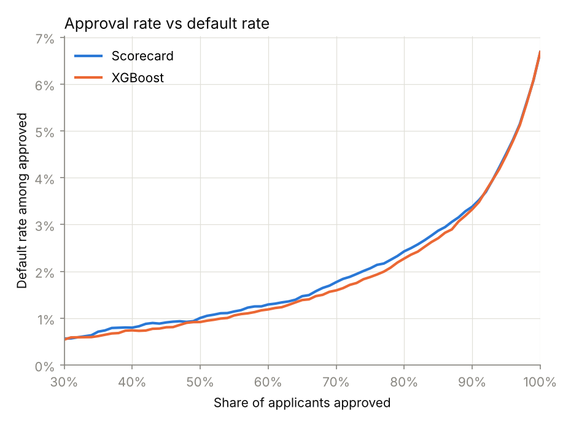
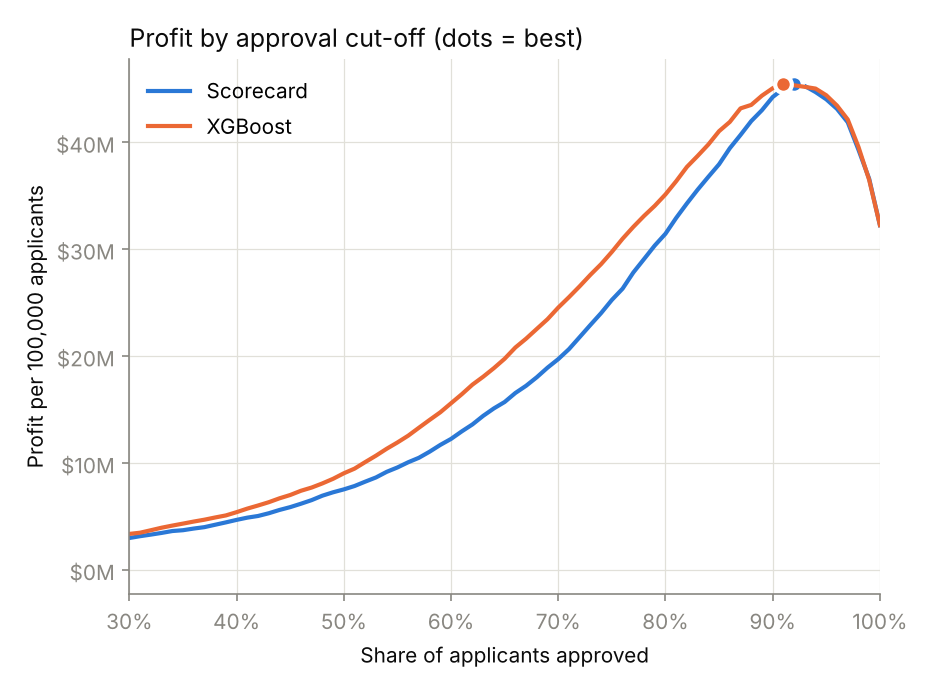
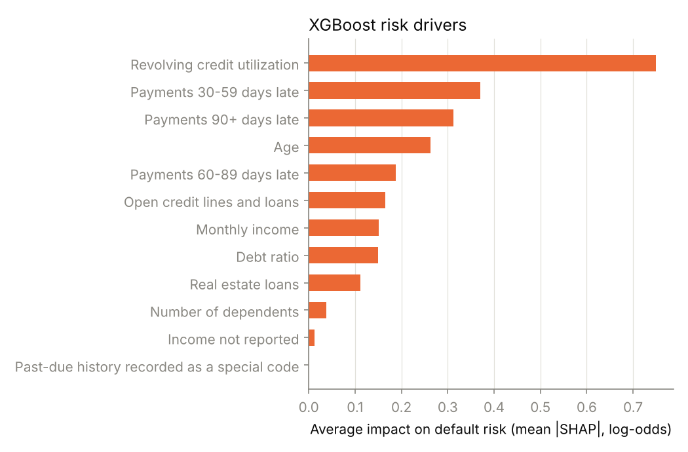

# Credit Lending Strategy — Scorecard vs XGBoost

Fintech lenders say they can safely approve borrowers that traditional banks turn away. This project tests a version of that claim, among borrowers who all received credit. It challenges the bank-style logistic scorecard from my [credit-risk-scorecard](https://github.com/pooja003-cloud/credit-risk-scorecard) project with an XGBoost model on **exactly the same borrowers**, then turns both models into lending decisions: whom to approve, how many defaults that brings, and how much profit it makes.

**Short answer:** XGBoost ranks risk slightly better (AUC 0.861 → 0.868) and its probabilities are better calibrated. At the profit-maximizing cut-off the two models are tied. For a selective lender, **XGBoost approves more applicants at the same default rate**: 3,477 more per 100,000 at a 2% target. How much extra profit that brings depends mostly on how much approved borrowers borrow: +37% under this project's assumption that each borrower keeps drawing their current utilization, but about +5% if everyone draws the same share of their limit. The borrowers it approves differently are a recognizable group: heavy credit users with clean payment histories.

> **Independent review.** My [credit-model-validation](https://github.com/pooja003-cloud/credit-model-validation) project re-tested these results and corrected some of them:
> - **Out of sample**, XGBoost approves **+2,907 more applicants per 100,000** at a 2% target (this README: +3,477), with profit uplift +33.6% (this README: +37%).
> - **About seven-eighths of the profit uplift depends on the drawn-balance assumption.** With a flat drawn balance, the uplift is +4.7%, which is simply the extra approvals.
> - **At the profit-maximizing cut-off, XGBoost is −0.4%, not +0.1%.** This project searched cut-offs in 1% steps, which slightly under-measured the scorecard's best profit.
>
> The figures below are this project's original results; the validation report explains each change.

## Why this approach

- **Same data, same split, same cleaning.** The project loads project 1's saved scorecard as-is (`baseline/`), uses its cleaning function, and evaluates both models on the same 30,000 hold-out borrowers. Any difference comes from the model, not the data.
- **XGBoost, kept simple.** Sensible default settings, no hyperparameter search. Trees need no scaling and handle missing values directly, so debt ratio, which the scorecard had to drop, goes back in.
- **Monotone constraints.** Credit utilization, late payments and debt ratio can only raise risk; age and income can only lower it. This keeps every risk factor explainable, and older applicants are never scored as riskier for their age (the Reg B rule). It costs 0.002 AUC.
- **No class weighting.** Only 6.7% of borrowers default, and the common "fix" (`scale_pos_weight`) inflates every predicted probability. A lender pricing loans needs probabilities that match reality, so the weighted model is shown only as a comparison.
- **Decisions, not just metrics.** A lender doesn't act on AUC; it acts on an approval cut-off. So the models are compared on approval rate, default rate and profit.

## Results (30,000 hold-out borrowers)

### Head-to-head

| Model | AUC | Gini | KS | Average PD | Actual default rate |
|---|---|---|---|---|---|
| Scorecard (project 1) | 0.861 | 0.721 | 0.557 | 6.65% | 6.68% |
| **XGBoost (monotone)** | **0.868** | **0.735** | **0.579** | **6.68%** | 6.68% |
| XGBoost, unconstrained | 0.870 | 0.739 | 0.583 | 6.69% | 6.68% |
| XGBoost, `scale_pos_weight` = 14 | 0.868 | 0.736 | 0.579 | 31.74% | 6.68% |

XGBoost improves AUC by 0.007 (0.8% relative). That's a realistic gain on this dataset. Class weighting leaves ranking unchanged but makes the average predicted PD **4.7 times too high**.

### Calibration: predicted PD ÷ actual default rate, by decile

| Decile | Actual rate (XGBoost deciles) | Scorecard | XGBoost | XGBoost weighted |
|---|---|---|---|---|
| 1 (safest) | 0.40% | 2.54 | 1.24 | 10.12 |
| 2 | 0.60% | 2.42 | 1.29 | 21.41 |
| 3 | 0.63% | 2.01 | 1.66 | 13.00 |
| 4 | 1.33% | 1.31 | 1.03 | 12.22 |
| 5 | 1.63% | 1.30 | 1.12 | 10.66 |
| 6 | 2.53% | 1.11 | 1.06 | 9.89 |
| 7 | 4.03% | 0.92 | 1.00 | 9.11 |
| 8 | 7.03% | 0.91 | 0.88 | 7.13 |
| 9 | 11.73% | 0.94 | 0.89 | 5.20 |
| 10 (riskiest) | 36.90% | 0.94 | 1.03 | 2.38 |

1.00 means perfect. XGBoost cuts the scorecard's overstatement for the safest borrowers from 2–2.5× to 1.2–1.7×, which was the main weakness found in project 1. The weighted model overstates risk in every decile, by up to 21×.

### The lending decision

Approve the lowest-risk applicants first. Profit is the realized two-year result on the hold-out set, scaled to 100,000 applicants.

<p align="center">
  
  
</p>

| Approve | Default rate: Scorecard | Default rate: XGBoost | Profit: Scorecard | Profit: XGBoost |
|---|---|---|---|---|
| 50% | 1.01% | 0.92% | $7.54M | $9.04M |
| 60% | 1.29% | 1.19% | $12.26M | $15.60M |
| 70% | 1.77% | 1.60% | $19.73M | $24.55M |
| 80% | 2.43% | 2.27% | $31.46M | $35.14M |
| 90% | 3.38% | 3.33% | $44.25M | $45.07M |
| 100% | 6.68% | 6.68% | $32.27M | $32.27M |

**Profit-maximizing cut-off:** the scorecard approves 92% (default rate 3.70%, $45.49M); XGBoost approves 91% (default rate 3.48%, $45.52M). **At the optimum, there's no meaningful difference:** +0.1% here on 1% steps, −0.4% when the validation searches every borrower. Under these assumptions almost every borrower is profitable, so both models approve nearly everyone and pick almost the same people.

### Risk appetite: where XGBoost earns its keep

Most lenders are more selective than the profit-maximizing point, to protect capital and manage loss volatility. Holding the default rate fixed:

| Target default rate | Approved: Scorecard | Approved: XGBoost | Extra approvals per 100,000 | Profit: Scorecard | Profit: XGBoost |
|---|---|---|---|---|---|
| 1.5% | 66.3% | 68.0% | +1,763 | $16.77M | $22.58M |
| 2.0% | 73.6% | 77.1% | +3,477 | $23.47M | $32.19M |
| 2.5% | 81.1% | 82.6% | +1,487 | $33.07M | $38.11M |
| 3.0% | 86.5% | 87.6% | +1,110 | $40.06M | $43.37M |

At the same default rate, XGBoost approves more applicants *and* earns $3–9M more per 100,000 applicants under this project's revenue assumption. The extra approvals are the robust part; most of the extra profit comes from XGBoost approving borrowers who carry larger balances (see *Assumptions*).

### Who gets approved differently?

At the same approval rate, compare the applicants only one model approves:

| Approve | Borrowers in each group | Default rate: XGBoost-only | Default rate: Scorecard-only | Credit used (mean): XGBoost-only | Credit used (mean): Scorecard-only |
|---|---|---|---|---|---|
| 70% | 976 | 3.07% | 6.86% | 73% | 25% |
| 80% | 835 | 5.99% | 10.42% | 86% | 45% |
| 90% | 330 | 15.15% | 19.70% | 79% | 60% |

At 70% approval:

| Approved only by… | Default rate | Credit used (median) | Any late payment | Age (median) | Income (median) |
|---|---|---|---|---|---|
| XGBoost | 3.07% | 75% | 9% | 57 | $7,117 |
| Scorecard | 6.86% | 21% | 49% | 49 | $4,500 |

**What the fintech claim looks like among approved borrowers.** Everyone in this dataset already received credit, so this can't show how applicants a bank actually rejected would perform (see *Limitations*). Within these borrowers, the scorecard adds risk factors up independently, so heavy credit use alone pushes clean, older, higher-income borrowers over the line, while it approves light credit users even though half of them have missed payments. XGBoost weighs the factors together. The borrowers it adds default at less than half the rate of those it drops. Because they use more of their credit, they also generate more interest revenue under this project's assumptions, which is where most of the profit difference comes from.

### Explaining XGBoost decisions

XGBoost computes SHAP values natively, splitting each prediction into contributions from each feature. These give overall risk drivers and per-applicant reason codes, which US lenders (fintechs included) must provide under ECOA / Regulation B when they decline someone.

<p align="center">
  
</p>

Utilization and late payments dominate, as in the scorecard. **Example decline** (a real hold-out applicant with the median PD among XGBoost declines): PD 34.8%, score 479. Reasons: payments 90+ days late (3 times), payments 30–59 days late (2 times), age (31). Age is a permitted factor under Regulation B for applicants under 62, but it's a sensitive one: the validation shows XGBoost weighs youth much more heavily than the scorecard, so "age" appears as a reason more often for young applicants.

## Conclusion

XGBoost is a better model here: slightly better ranking, much better calibration, and explainable once constrained. Whether that's worth the extra complexity depends on the lender. **For a selective lender, it adds roughly 1,000–3,500 approvals per 100,000 applicants at the same default rate.** The extra profit ranges from about +5% to +37%, depending on how much those borrowers draw on their credit. For a lender already approving almost everyone, the gain is negligible, and the simpler, fully transparent scorecard may still be the better choice.

## Assumptions (illustrative)

The same credit card product as project 1's expected-loss estimate:

- **Credit limit:** $10,000 per approved borrower
- **Revenue:** good borrowers pay 20% APR on their drawn balance, minus 6% cost of funds and servicing, for two years
- **Loss:** defaulting borrowers lose 80% (LGD) of their exposure, where exposure = drawn balance + 50% of the unused limit
- **Drawn balance:** each borrower's revolving utilization (capped at 100%) × the limit. **This is the assumption that drives the profit results.** Because revenue rises with utilization, and XGBoost approves heavier credit users, it earns more partly by construction. With a flat drawn balance for everyone, the validation finds the profit uplift at a 2% target falls from +37% to +4.7%, the same as the increase in approvals.

## Method

1. **Data** — project 1's `clean()`: flags for the 96/98 past-due codes and for missing income, then the same stratified 80/20 split (`random_state=42`).
2. **Baseline** — project 1's saved scorecard (`baseline/outputs/scorecard_model.pkl`, from commit `aa5508d`), loaded without retraining.
3. **Challenger** — XGBoost (400 trees, depth 4, learning rate 0.05) on the scorecard's 11 features plus debt ratio, with monotone constraints. Unconstrained and class-weighted versions are trained for comparison only.
4. **Validate** — AUC, Gini, KS and 10-decile calibration for every model.
5. **Strategy** — approval rate vs default rate vs profit for every cut-off; the profit-maximizing cut-off; approvals at fixed target default rates.
6. **Swap set** — compare the applicants each model approves that the other declines, at the same approval rate.
7. **Explain** — SHAP drivers and reason codes for a declined applicant.

## Project structure

```
credit-lending-strategy/
├── strategy.py             # the full comparison and strategy analysis
├── requirements.txt        # pinned versions
├── baseline/               # project 1's scorecard, used as-is
│   ├── scorecard.py
│   └── outputs/scorecard_model.pkl
├── data/                   # place credit_data.csv here (not tracked)
└── outputs/
    ├── approval_vs_default.png
    ├── profit_by_cutoff.png
    ├── xgboost_drivers.png
    ├── strategy_curve.csv   # every cut-off from 1% to 100%
    ├── risk_appetite.csv
    ├── swap_set.csv
    ├── xgboost_drivers.csv
    ├── xgboost_model.json   # the trained XGBoost model
    └── run_output.txt       # full console output of the latest run
```

## How to run

1. Download `cs-training.csv` from the [Give Me Some Credit competition](https://www.kaggle.com/c/GiveMeSomeCredit/data) (free Kaggle account required).
2. Save it as `data/credit_data.csv`.
3. Install and run (Python 3.11 or newer):

```bash
python3 -m venv .venv && source .venv/bin/activate
pip install -r requirements.txt
python strategy.py
```

The dataset is not included in this repository, in line with Kaggle's competition rules.

## Limitations and next steps

- **No reject inference.** The dataset only contains people who already received credit. The comparison shows which model better ranks *these* borrowers; it can't show how applicants that a bank actually rejected would have performed. Real fintechs address this with reject inference or small controlled test approvals.
- **Cut-offs are chosen and evaluated on the same hold-out set.** This flatters both models equally, so the comparison is fair, but absolute profits are slightly optimistic. A production analysis would pick cut-offs on a separate validation set.
- **Profit depends on the drawn-balance assumption most of all.** Interest revenue is tied to each borrower's current utilization, which assumes today's balance predicts the balance they'll carry after approval. That is plausible for credit cards but not tested here; account-level balance histories would be needed.
- **Profit depends on the other assumptions too.** The 91–92% optimal approval rate reflects generous margins and no acquisition, marketing or operating costs beyond funding. Tighter margins would move the optimum lower, toward the range where XGBoost's advantage is largest.
- **Small groups are noisy.** The safest deciles have about 12–19 defaults each, and the swap groups have a few hundred to a thousand borrowers, so differences of a few tenths of a percentage point aren't meaningful.
- **Fair-lending testing not done.** Monotone constraints keep factors explainable, but a production model would also be tested for disparate impact across protected groups.
- **The past-due code flag has no effect in XGBoost** (SHAP ≈ 0), because the tree uses the missing past-due values directly.

## Data

[Give Me Some Credit](https://www.kaggle.com/c/GiveMeSomeCredit) (Kaggle, 2011): 150,000 borrowers, 10 numeric features, target `SeriousDlqin2yrs` (90+ days past due within two years).
